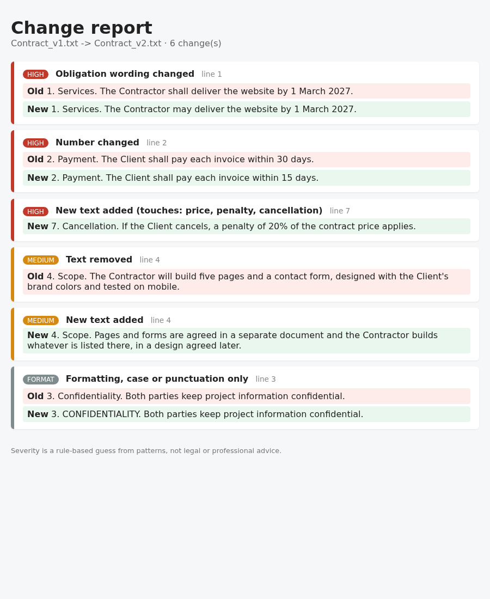
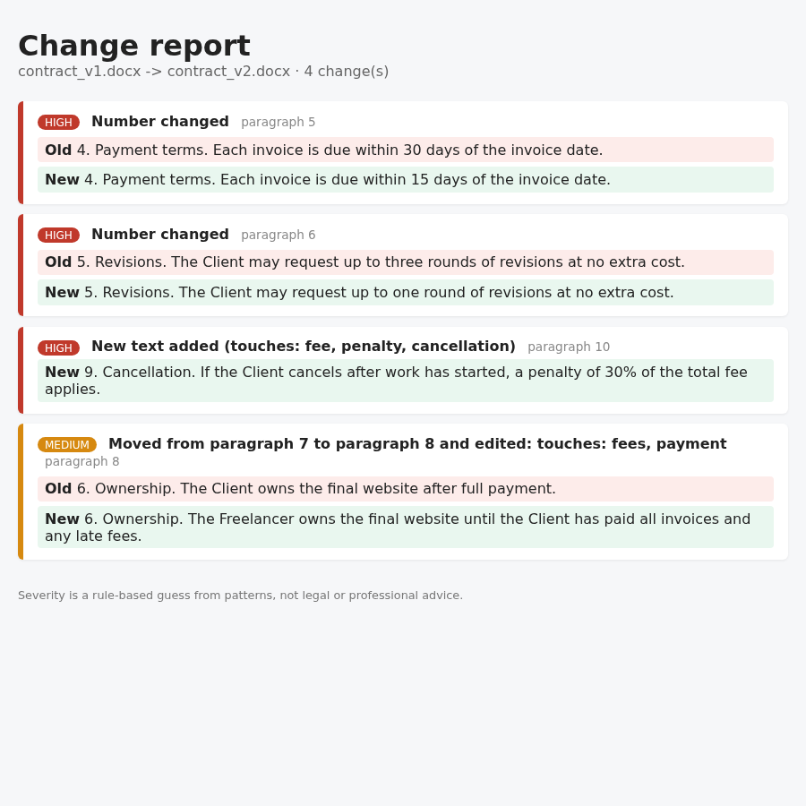

# ChangeLens

[](https://github.com/Hamasa-ElShamy/changelens/actions/workflows/tests.yml)  

**Someone sent you "the updated version". What actually changed?**

ChangeLens compares two versions of a document and reports each change with a severity (HIGH, MEDIUM, LOW) and a short reason, instead of dumping a raw diff. A "What's Important?" mode hides formatting-only and trivial changes.

Runs offline. No AI model: severity comes from readable rules in [`changelens/rules.py`](changelens/rules.py).



**Live demo in your browser (works on phones):** https://hamasa-elshamy.github.io/changelens/demo.html (plain text only, nothing is uploaded).

PDF reading uses [pypdfium2](https://github.com/pypdfium2-team/pypdfium2) (Apache-2.0 / BSD, PDFium). No AGPL code is installed.

## Supported files

`.txt` `.md` `.docx` `.pdf` `.xlsx` `.pptx` (slide text, tables and speaker notes). Both files must be the same family (two text documents, or two spreadsheets).

## Install and use

```bash
git clone https://github.com/Hamasa-ElShamy/changelens
cd changelens
pip install -e .

changelens old.docx new.docx                 # text report
changelens old.pdf new.pdf --important       # What's Important? mode
changelens old.xlsx new.xlsx --json          # for scripts
changelens old.txt new.txt --html report.html
```

Exit code is 1 if any HIGH change is found, 0 otherwise, 3 on read errors.

Real output from [`demo/`](demo/) (more in `demo/demo-output.txt`):

```
[HIGH] Obligation wording changed  (line 1)
    Old: 1. Services. The Contractor shall deliver the website by 1 March 2027.
    New: 1. Services. The Contractor may deliver the website by 1 March 2027.

[HIGH] Number changed  (line 2)
    Old: 2. Payment. The Client shall pay each invoice within 30 days.
    New: 2. Payment. The Client shall pay each invoice within 15 days.

[HIGH] New text added (touches: price, penalty, cancellation)  (line 7)
    New: 7. Cancellation. If the Client cancels, a penalty of 20% of the contract price applies.
```

## Worked examples

Sample input files and the real output they produce are in [`examples/`](examples/). Rebuild them with `python examples/make_examples.py && python examples/run_examples.py`.

**1. A freelance contract (Word).** `contract_v1.docx` vs `contract_v2.docx`:

```
changelens examples/contract_v1.docx examples/contract_v2.docx
```
```
[HIGH] Number changed  (paragraph 5)
    Old: 4. Payment terms. Each invoice is due within 30 days of the invoice date.
    New: 4. Payment terms. Each invoice is due within 15 days of the invoice date.

[HIGH] Number changed  (paragraph 6)
    Old: 5. Revisions. The Client may request up to three rounds of revisions at no extra cost.
    New: 5. Revisions. The Client may request up to one round of revisions at no extra cost.

[HIGH] New text added (touches: fee, penalty, cancellation)  (paragraph 10)
    New: 9. Cancellation. If the Client cancels after work has started, a penalty of 30% of the total fee applies.

[MEDIUM] Moved from paragraph 7 to paragraph 8 and edited: touches: fees, payment  (paragraph 8)
    Old: 6. Ownership. The Client owns the final website after full payment.
    New: 6. Ownership. The Freelancer owns the final website until the Client has paid all invoices and any late fees.
```

"three rounds" to "one round" is caught because number words count as numbers. The ownership clause moved down and was rewritten, and it is reported as one change, not a removal plus an addition.

**2. A budget (Excel)**, cell by cell: `Budget!B2` 4000 to 5200 (HIGH), the total `Budget!B5` 5700 to 7500 (HIGH), and a new Insurance row. See [`examples/budget-output.txt`](examples/budget-output.txt).

**3. A pitch deck (PowerPoint).** Price on slide 1 went from EGP 20,000 to EGP 26,000 (HIGH) and the speaker note changed from "Mention the warranty period" to "Warranty is not included". See [`examples/deck-output.txt`](examples/deck-output.txt).

**4. Arabic text.** `٣٠` vs `١٥` digits and a new penalty clause (`غرامة`) are caught. See [`examples/arabic-output.txt`](examples/arabic-output.txt).



## Install on Windows, macOS and Linux

Needs Python 3.9 or newer. On Windows install it from python.org and tick "Add python.exe to PATH".

```bash
# Windows (PowerShell):  py -m pip install git+https://github.com/Hamasa-ElShamy/changelens
# macOS:                 python3 -m pip install git+https://github.com/Hamasa-ElShamy/changelens
# Linux:                 python3 -m pip install --user git+https://github.com/Hamasa-ElShamy/changelens
```

Tested on Linux only. Android: use the live demo in the phone browser (plain text only). Technical notes (architecture, algorithms, testing): [ARCHITECTURE.md](ARCHITECTURE.md). Website: https://hamasa-elshamy.github.io/changelens/

## How it works

1. **Extract** the text: paragraphs and table rows for Word, text blocks per page for PDF, one entry per cell for Excel.
2. **Align** the two versions. Text is matched block by block with Python's `difflib`; a changed block is paired with its most similar block in the new version. Excel cells are matched by address (for example `Results!D14`).
3. **Judge** each difference with rules:
   - a number, amount or percentage changed (Arabic digits count as the same numbers): HIGH
   - an obligation word changed, such as `shall` to `may`: HIGH
   - number words count as numbers ("three" equals 3)
   - a negation was added or removed: HIGH
   - a new or removed clause mentioning payment, penalty, termination, liability and similar words: HIGH or MEDIUM
   - most of a block was rewritten: MEDIUM
   - only case, spacing or punctuation changed: FORMAT (hidden by `--important`)
4. **Report** in the terminal, JSON or a styled HTML page.

## Limitations

- Severity is a guess from patterns. It can miss an important change and can rate a harmless one HIGH. It is not legal advice. Read the HIGH items yourself.
- Moved paragraphs are detected when the text is nearly identical (85% similar) or the clause label (such as "6. Ownership") matches. A paragraph that was moved and heavily rewritten with no matching label still shows as one removed and one added block.
- PDF comparison relies on extractable text. Scanned PDFs and images (OCR) are not supported yet.
- PowerPoint compares slide text, tables and notes, not images or charts. Word comparison ignores headers, footers, text boxes and tracked-change markup.
- Excel: only cell values and formulas as text are compared, not formatting, charts or hidden sheets.
- The keyword lists cover English and some Arabic. Other languages only get the number and formatting checks.
- There is no desktop window yet, only the CLI and HTML report.

## Development

```bash
pip install -e ".[dev]" && pytest
```

## Roadmap (not yet built)

OCR for scanned documents, desktop window, optional LLM explanation of changes.

## License

MIT

## Related tools

Document comparison tools exist, including [docdiff](https://github.com/tschnorpfeil/docdiff), [DocumentDiffCheck](https://github.com/NickZaitsev/DocumentDiffCheck), [redline-summarizer](https://github.com/noamrazbuilds/redline-summarizer) and [contract-diff](https://github.com/AlperNab/contract-diff), some of them AI-based. ChangeLens differs by running fully offline with no AI service, by labelling each change by type (for example number or obligation wording), and by a browser demo that runs without uploading your file. It does not do semantic comparison.
